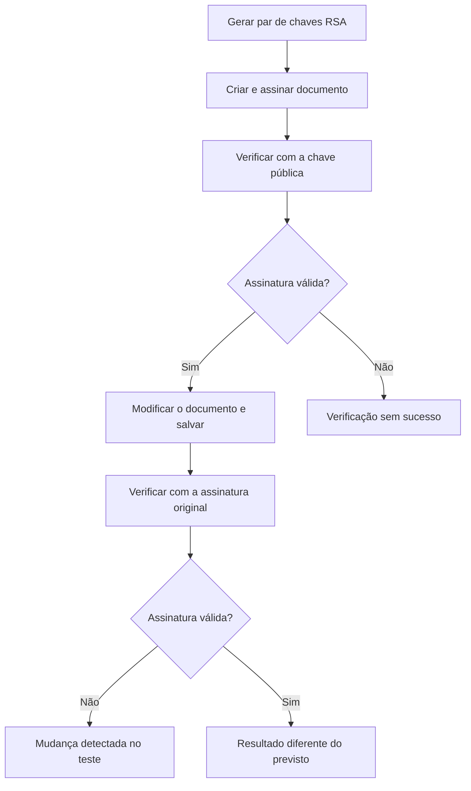

# Assinatura digital e verificação de documentos com OpenSSL

## Visão geral

Este laboratório aborda como assinar um arquivo e verificar se ele foi alterado. A atividade utiliza OpenSSL, chaves RSA e SHA-256 para demonstrar dois cuidados de segurança: conferir a assinatura e detectar mudanças no conteúdo.

O procedimento inclui criar um par de chaves, assinar um documento, verificar a assinatura e repetir a verificação após modificar o texto. Esta documentação foi organizada a partir do roteiro fornecido; os resultados apresentados são os previstos nesse material, sem afirmar uma execução prática independente.


---

## Origem do laboratório

| Informação | Descrição |
|---|---|
| Plataforma | Cisco Networking Academy (NetAcad) |
| Atividade | Gerar e usar uma assinatura digital |
| Tipo | Laboratório educacional |
| Ambiente indicado | CSE-LABVM no VirtualBox |
| Ferramenta principal | OpenSSL |

A atividade pertence à Cisco Networking Academy. Esta documentação apresenta uma síntese própria do procedimento e dos conceitos estudados.

---

## Objetivos de aprendizagem

- Entender a função das chaves privada e pública.
- Conhecer o processo de assinatura de um arquivo.
- Verificar uma assinatura com a chave pública correspondente.
- Compreender por que uma alteração no documento invalida a assinatura original.
- Relacionar a verificação de documentos à proteção das informações.

---

## Ferramentas e tecnologias

| Recurso | Finalidade na atividade |
|---|---|
| CSE-LABVM | Ambiente virtual indicado para realizar o exercício. |
| VirtualBox | Programa utilizado para executar a máquina virtual. |
| Terminal Linux | Local de execução dos comandos. |
| OpenSSL | Ferramenta para criar chaves, assinar e verificar o documento. |
| RSA | Algoritmo utilizado no par de chaves. |
| SHA-256 | Função que produz um resumo do conteúdo para o processo de assinatura. |
| Gedit | Editor indicado para modificar o documento no teste. |

---

## Arquivos envolvidos

| Arquivo | Função | Cuidado |
|---|---|---|
| `private_key.pem` | Chave privada utilizada para assinar. | Manter em segredo e fora do repositório. |
| `public_key.pem` | Chave pública utilizada para verificar a assinatura. | Confirmar sua origem antes de confiar na identidade do assinante. |
| `contract.txt` | Documento utilizado no exercício. | A verificação depende do conteúdo exato do arquivo. |
| `signature` | Assinatura digital separada do documento. | Utilizar com o documento e a chave pública correspondentes. |

O arquivo `signature` é binário, por isso seu conteúdo não aparece como um texto legível comum.

---

## Procedimento do laboratório

Os comandos abaixo descrevem o procedimento do material. O nome do documento foi padronizado como `contract.txt`, pois o roteiro alterna grafias e letras maiúsculas. Em Linux, nomes com maiúsculas e minúsculas podem identificar arquivos diferentes.


---

### 1. Preparar o ambiente

Iniciar a CSE-LABVM no VirtualBox e abrir o terminal. Os arquivos utilizados nas próximas etapas devem estar no mesmo diretório de trabalho.

---

### 2. Gerar a chave privada

```bash
openssl genpkey -algorithm RSA -out private_key.pem
```

A chave privada será utilizada para criar a assinatura. Quem tiver acesso a ela poderá assinar arquivos com essa chave.

---

### 3. Extrair a chave pública

```bash
openssl pkey -in private_key.pem -pubout -out public_key.pem
```

A chave pública correspondente permite verificar a assinatura. O destinatário não precisa conhecer a chave privada de quem assinou.

---

### 4. Criar o documento

Criar o arquivo `contract.txt` com uma mensagem fictícia. O roteiro utiliza uma instrução de transferência e depois modifica o nome do destinatário para simular uma adulteração.


---

### 5. Assinar o arquivo

```bash
openssl dgst -sha256 -sign private_key.pem -out signature contract.txt
```

O comando utiliza SHA-256 e a chave privada para gerar a assinatura do documento. O resultado fica no arquivo separado `signature`.

---

### 6. Verificar o documento original

```bash
openssl dgst -sha256 -verify public_key.pem -signature signature contract.txt
```

A verificação deve ser bem sucedida quando documento, assinatura e chave pública correspondem. Isso confirma que a assinatura é válida para aquele conteúdo e aquela chave.

---

### 7. Modificar o documento

```bash
gedit contract.txt
```

Alterar o destinatário da mensagem e salvar o arquivo. Manter a assinatura original para observar o efeito da mudança.

---

### 8. Repetir a verificação

```bash
openssl dgst -sha256 -verify public_key.pem -signature signature contract.txt
```

Após a alteração, a assinatura original deixa de corresponder ao conteúdo. A falha demonstra como a verificação pode detectar uma mudança no documento.

---

## Fluxograma do processo



O fluxo representa o teste orientado pelo laboratório. Fora desse teste controlado, uma falha também pode ocorrer por uso de chave pública ou assinatura incorreta, e precisa ser investigada.

---

## Verificações previstas

| Verificação | Objetivo | Resultado previsto no roteiro | Fonte |
|---|---|---|---|
| Documento original | Conferir a correspondência entre conteúdo, assinatura e chave pública. | Verificação bem-sucedida. | Parte 6 do material fornecido. |
| Documento modificado | Observar o efeito de alterar o conteúdo mantendo a assinatura original. | Falha na verificação. | Parte 8 do material fornecido. |

---

## Principais aprendizados

- A chave privada assina e a chave pública correspondente verifica.
- A assinatura está vinculada ao conteúdo exato do arquivo: uma mudança pode invalidá-la.
- Assinar um documento não oculta seu conteúdo. A proteção de leitura exige outro mecanismo.
- Uma assinatura válida demonstra correspondência com uma chave. Para associá-la a uma pessoa ou empresa, também é necessário confiar na origem da chave pública.
- Proteger a chave privada é essencial para evitar assinaturas indevidas.

Esses conceitos ajudam a compreender verificações de arquivos, investigar falhas de assinatura e orientar usuários sobre cuidados com documentos digitais, em atividades de Suporte de TI e Cibersegurança.

---

## Entendendo os termos técnicos

| Termo | O que significa? |
|---|---|
| Assinatura digital | Informação criptográfica que permite verificar a assinatura de um conteúdo e detectar alterações. |
| Chave privada | Informação secreta usada para assinar, que deve ficar protegida. |
| Chave pública | Informação que pode ser compartilhada para verificar assinaturas da chave privada correspondente. |
| RSA | Algoritmo que trabalha com um par de chaves, uma pública e outra privada. |
| Hash | Resumo calculado a partir de um conteúdo; alterações normalmente produzem outro resumo. |
| SHA-256 | Função de hash utilizada no processo de assinatura deste exercício. |
| Integridade | Condição de um conteúdo que permanece sem alterações em relação ao original verificado. |
| Autenticidade | Confiança na origem de algo; neste exercício, a verificação relaciona a assinatura à chave utilizada. |

---

## Onde esse conhecimento pode ser aplicado?

**Cenário fictício: uma solicitação de pagamento alterada**

**Situação:** uma empresa recebe um arquivo com uma solicitação de pagamento assinada digitalmente. Antes de prosseguir, a equipe precisa verificar se o documento corresponde ao que foi assinado.

**Aplicação:** o profissional de TI orienta a conferência usando a assinatura e uma chave pública obtida de fonte confiável. Se alguém modificar o destinatário depois da assinatura, a verificação com a assinatura original falha e o caso precisa ser investigado antes de seguir.

**Benefício e relação com o laboratório:** a conferência ajuda a identificar alterações antes de utilizar o documento. É o mesmo princípio demonstrado ao modificar `contract.txt` e repetir a verificação. A assinatura, por si só, não confirma que o pagamento foi autorizado.

